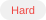

# 85. Maximal Rectangle

Given a `rows x cols` binary `matrix` filled with `0`'s and `1`'s, find the largest rectangle containing only `1`'s and return its area.

### Example 1
> 
>
> **Input**: matrix = [["1","0","1","0","0"],["1","0","1","1","1"],["1","1","1","1","1"],["1","0","0","1","0"]]
>
> **Output**: 6
>
> **Explanation**: The maximal rectangle is shown in the above picture.

### Example 2
> **Input**: matrix = [["0"]]
>
> **Output**: 0

### Example 3
> **Input**: matrix = [["1"]]
>
> **Output**: 1

## Constraints
- `rows == matrix.count`
- `cols == matrix[row].count`
- `1 <= rows, cols <= 200`
- `matrix[row][column]` is `"0"` or `"1"`.

---

Links:
* _LeetCode URL_: https://leetcode.com/problems/maximal-rectangle/description/
* _Wiki_: https://leetcode.doocs.org/en/lc/85/
